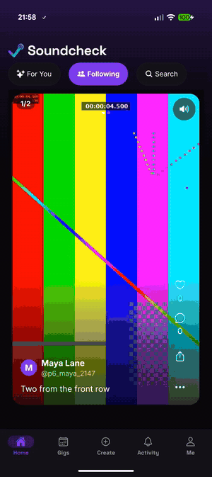
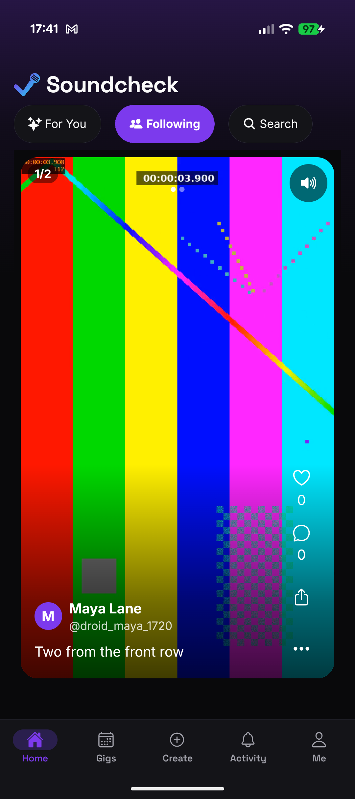
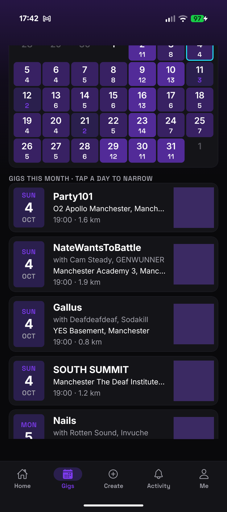
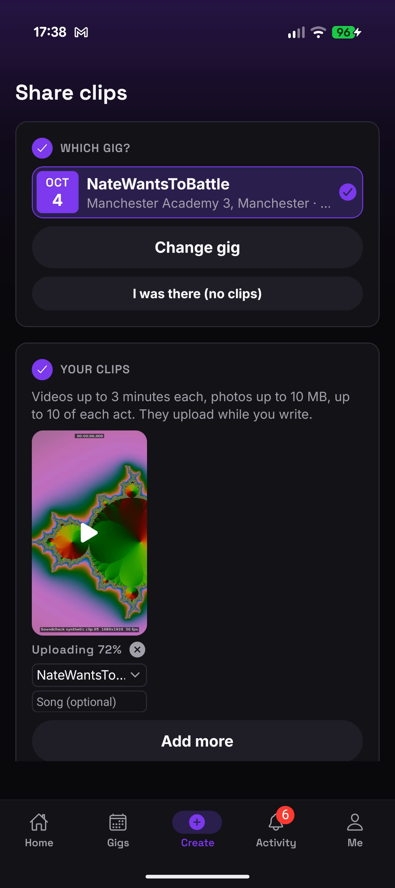
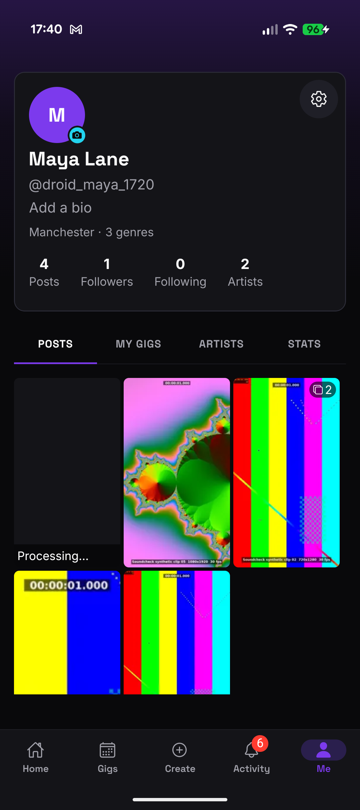
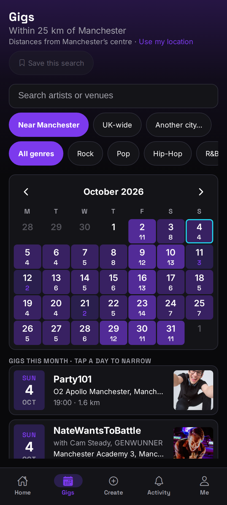
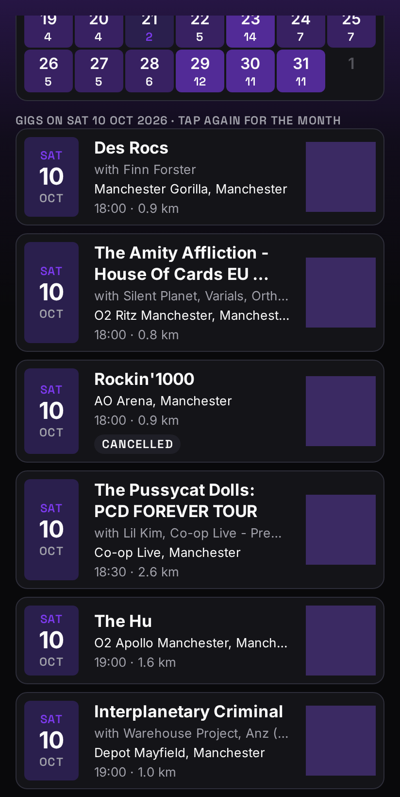
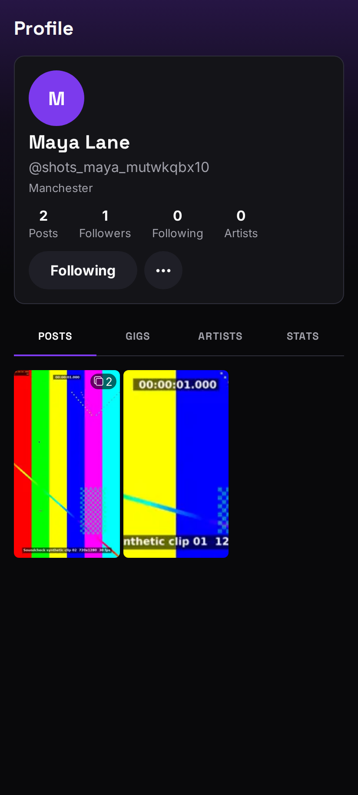
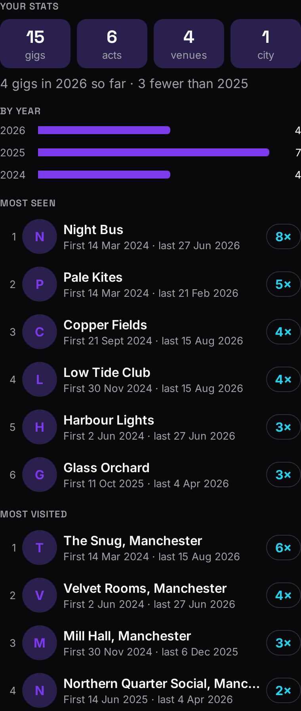
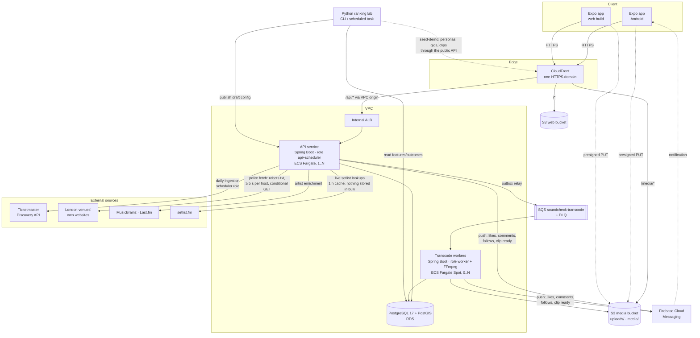

# Soundcheck

Discover live music near you, share concert clips, and get a feed that learns what you care about.

> **Status (2025-08-31):** the core is built and verified against the local stack: five rounds of phone feedback on a Pixel, the Android smoke checklist passed on a release APK (`make apk`), 8 web journeys in CI, push notifications through Firebase. Open: the from-empty seeding run, which moves to the new AWS database. Measured performance numbers, the admin console and ranking lab (in progress) and the AWS deployment with a live URL come next.

Soundcheck is a music social app (Java/Spring Boot + PostgreSQL API, React Native client, S3 video storage), built to scale.

## What's interesting here
- **Scalable media pipeline** — direct-to-S3 resumable uploads, transactional outbox → SQS → FFmpeg workers on Fargate Spot scaling with queue depth, HLS adaptive streaming through CloudFront.
- **Personalised ranking you can see inside** — candidate generation, a transparent logistic scorer with per-item explanations, diversity re-ranking, exploration, and a live tuning console.
- **Offline learning loop** — serve-time feature logging, a Python lab that trains and evaluates new weights, and a human-approved publish/activate flow; Java/Python parity tests.
- **Real data integration** — UK gigs from Ticketmaster and from London venues' own websites (read politely: robots.txt, per-host spacing, conditional requests), enriched with MusicBrainz and Last.fm, with entity resolution and matching of the same show across sources (venue, night, shared act); setlists looked up live from setlist.fm.
- **Measured performance** — million-row datasets, k6 load tests and an EXPLAIN-driven before/after report.
- **Infrastructure as code** — AWS CDK stacks deployed from the laptop with one command, a dry run and typed confirmations, alarms, a budget and a pause/resume cost brake.

## What it does today
- **Gigs** — real UK gigs from Ticketmaster (a year ahead) plus 21 grassroots London venues read from their own what's-on pages (on in the local profile only, off by default elsewhere), enriched from MusicBrainz and Last.fm and matched across sources so one show stays one gig; fans add the gigs no source lists, including past ones found on setlist.fm. A calendar with ranked artist and venue suggestions, several picks at once, near home / UK-wide / another city, saved searches; gig pages with a bar of the bill's acts, each with its own setlist and clips.
- **Clips** — record or pick, upload straight to S3 in resumable parts (compressed only on mobile data), transcoded by FFmpeg workers into an HLS ladder, played adaptively on Android and the web.
- **Social** — posts tagged with the gig and acts, likes, comments, follows, blocks, an Activity inbox driven by domain events and pushed to the phone through Firebase Cloud Messaging (Android; off until a Firebase project is set up), account deletion with a 7-day purge.
- **For You** — candidates from seven SQL generators, twelve features, a logistic score with “Why this post?” reasons, diversity re-ranking and exploration, sessions, and a serve-time feature log for the Python lab.
- **Your stats** — the acts you have seen most and the venues you go back to, counted from the gigs you marked Went (support acts included); private until you share them.
- **Demo data** — `make seed-demo` seeds 30 personas, a demo fan with the owner's real gig history and own concert clips (local only, never committed) and a scripted engagement pass, all through the public API and safe to re-run.
- **Security basics** — rate limits on sign-in, uploads, events and every signed-in user (300 requests a minute), Problem Details errors that carry a `traceId` and nothing internal, uploaded images served without their EXIF/GPS, CORS only for the local origins.

## Screenshots


Real screens with synthetic accounts and clips (`make clips`), dark mode; Ticketmaster's artist photos are masked. Provenance (date, commit, how they were taken) is in `docs/screens/web/README.md` and `docs/screens/android/README.md`.

| Android (on a Pixel) | | | |
|---|---|---|---|
|  |  |  |  |
| Following: a post of two clips | Gigs near home, distances | Create: uploading while you write | Your grid: Processing… |

| Web | | | |
|---|---|---|---|
|  |  |  |  |
| Gigs: the calendar with counts | A real cancelled gig's badge | Someone's profile | Your stats: acts and venues |

## Architecture
One Spring Boot jar in three process roles (`api`, `scheduler`, `worker`) as a modular monolith (Spring Modulith: eleven modules, boundaries checked by a test), one PostgreSQL + PostGIS database, S3 for media, SQS for transcode jobs, and an Expo app for Android and the web. The deployed shape:



Ingestion (Ticketmaster, the venue sites, enrichment) runs in the `scheduler` role, which shares the API service; setlists are looked up when a past gig's page is opened, and the venue sites are read under a compliance gate. Locally the same shape runs in Docker Compose: **Caddy** plays CloudFront (the same path routing on `localhost:8088`, and the security headers CloudFront will add), **LocalStack** plays S3 and SQS, **PostGIS** plays RDS, and **Grafana LGTM** collects the OpenTelemetry traces and metrics. AWS is not deployed yet, and the lab's train/publish loop is still to come.

## Repository guide
| Path | Contents |
|---|---|
| `docs/SETUP.md` | Accounts, keys and Ubuntu toolchain |
| `backend/` | Spring Boot 3.5 / Java 21 modular monolith (Spring Modulith, jOOQ, Flyway); roles `api`, `scheduler`, `worker` |
| `app/` | Expo SDK 53 universal app (Android + web + admin console), TypeScript, Expo Router, TanStack Query, orval client |
| `lab/` | Python 3.13 ranking lab (uv, typer CLI `soundcheck-lab`): scorer parity, and the demo seeding client (`seed-demo`) |
| `infra/` | AWS CDK v2 (TypeScript) stacks with cdk-nag |
| `contracts/` | `openapi.json` snapshot and `ranking/feature-schema.json`, shared by backend, app and lab |
| `ops/` | Local stack: Caddy edge, LocalStack init hooks (resources, clip restore), Grafana provisioning; scripts (synthetic clips, app icons, fixtures, local status, pruning lost clips) |
| `load/` · `fixtures/` | k6 scenarios · synthetic API pages and clips (the owner's real clips in `fixtures/clips/mine/` are gitignored and stay on the owner's laptop) |
| `.github/` | CI (path-filtered jobs, gitleaks), CodeQL, Dependabot |

## Quick start
Prerequisites: `docs/SETUP.md` Parts A–B (accounts, keys, Ubuntu toolchain).

```bash
git clone git@github.com:alexslater1/soundcheck.git && cd soundcheck
make setup          # checks the toolchain, creates .env from .env.example — set the API keys
make dev            # all of the below in ONE terminal: containers, API + worker in the background (logs in .localdata/logs/), Expo in front; Ctrl+C stops them
make dev ANDROID=1  # the same, but rebuilds and installs the Android dev build instead of plain Expo (after native changes)
# …or one service per terminal:
make up             # db, localstack, lgtm, edge (Docker Compose); waits until healthy
make api            # terminal 1 — API on :8080 (first run downloads Gradle deps and generates jOOQ code, ~1–2 min)
make worker         # terminal 2 — transcode worker (role worker)
make app            # terminal 3 — Expo dev server; press w for web, or open http://localhost:8088
make android        # build + install the dev build on the connected phone (needs JDK 17, see below); only after native changes
make phone          # just the phone's port forwards (adb reverse): rerun after replugging USB when the app is already installed
make apk            # a release APK for rehearsal: JS bundled in (no Metro), the local edge via adb reverse, debug-signed; ~6 GB free (stop make dev)
adb install -r app/android/app/build/outputs/apk/release/app-release.apk   # replaces the dev build (same package); make android puts it back
make status         # what is running: containers, api/worker/expo, build daemons, phone forwards
make help           # every target with a one-line description
```

Data (needs `make up`; the seeding also `make api` and `make worker`):
```bash
make ingest                              # one gig ingestion run (INGESTION_MODE in .env; offline: make ingest INGESTION_MODE=fixtures)
make venue-preview SITES=the-lexington   # what a venue site would give (live fetch, robots.txt honoured), nothing written
make venue-coverage                      # after an ingest: per venue, its shows in the next 60 days that Ticketmaster misses
make seed-demo                           # personas, the demo fan's gigs and clips, likes, engagement (idempotent; SEED_ARGS="--personas 3 --gigs 2")
make media-snapshot                      # copy the clips out of LocalStack now (make down does it too)
make prune-local                         # mark posts whose clip files LocalStack lost as deleted
make backup                              # database, every clip and the seed's state → .localdata/backups/<stamp>/
make restore BACKUP=.localdata/backups/<stamp>   # put a backup back (stop make dev first; asks unless YES=1)
make seed-acceptance                     # backup, then seed from an empty stack in < 15 min and check every For You
```

## Stopping
1. **Ctrl+C** in each terminal: `make api`, `make worker`, `make app` (or `make android`, which stays running as the bundler).
2. **`make down`** first copies the clips out of LocalStack (its free edition forgets the bucket when it stops; the next `make up` puts them back), then stops the containers (data is kept), stops the Gradle and Kotlin build daemons, and finally lists anything still running, with how to stop it. It should end with `Nothing left running.`

That is all. The build daemons are why step 2 does more than `docker compose down`: Gradle keeps a background process after every build (backend and Android), and the Android build adds a Kotlin compile daemon. They hold up to ~2 GB each and only exit after ~3 hours idle. `make stop-daemons` stops just those, at any time. `make reset` is `make down` plus deleting the volumes (empty database, LocalStack and the saved clips). Stopping Docker any other way (a reboot, `docker compose down`) skips the copy: clips posted since the last `make down` or `make media-snapshot` are then lost, and their posts say "This clip could not be played". The adb server is left running: it is tiny and shared with Android Studio (`adb kill-server` stops it).

Then: http://localhost:8088 shows the app (Settings → About shows the API's status); http://localhost:8088/api/v1/health answers directly;
Grafana at http://localhost:3000 (Explore → Tempo → `{ resource.service.name = "soundcheck" }`) shows the trace.

Checks: `make verify` (backend build + tests, app lint/typecheck/tests, orval drift, infra tests, lab checks) · `make test` · `make lab-check` · `make e2e` (Playwright web journeys through the edge) · `make openapi` / `make openapi-check`.

Edge: http://localhost:8088 · API: http://localhost:8080 · Expo web: http://localhost:8081 · Grafana: http://localhost:3000 · LocalStack: http://localhost:4566

Notes: the backend needs Docker running (jOOQ code is generated from a throwaway PostGIS container at build time, and the integration tests start their own PostGIS and LocalStack containers). The Android Gradle build needs JDK 17 (`sdk install java 17.0.x-tem`; JDK 24+ breaks AGP's CMake step) while the backend uses JDK 21 — `make android` picks the SDKMAN JDK 17 automatically when present. Targets that are not built yet print `not yet implemented` and exit 1. The compose stack publishes Postgres, LocalStack and Grafana (anonymous Admin) on every network interface: bind them to `127.0.0.1` in `compose.yaml` before demoing on a shared network.

## Running on AWS
**Not deployed yet.** The stacks, the images and the commands below are written; the first real deploy is still to come. Everything here runs from the laptop; there is no CI deploy.

**Account, region and the Free plan.** One standard AWS account (e-mail sign-up; the root user has MFA and stays locked away), used through an IAM Identity Center user with the SSO profile `soundcheck`. The region is **eu-north-1** (Stockholm) by choice: the profile, the stacks and the scripts all pin it. Global services (IAM, CloudFront) work as usual. **The account is on the Free plan: AWS closes it when the sign-up credits are used up, or after six months, and keeps its content for 90 days.** The $50 budget alerts by e-mail long before that.

**Once, before the first deploy:**
```bash
aws configure sso --profile soundcheck                      # once: the IAM Identity Center start URL, region eu-north-1, the account and permission set
aws sso login --profile soundcheck                          # opens the browser; run it again when the session expires
aws configure set region eu-north-1 --profile soundcheck
make aws-check        # read-only: sign-in and expiry, CDK bootstrap, Fargate quotas, PostgreSQL versions, the CloudFront prefix list, stacks, .env keys (names only)
make aws-bootstrap    # once per account: CDK's own CDKToolkit stack
```
In `.env`: `AWS_ALARM_EMAIL` (where alarms go), and for telemetry `GRAFANA_OTLP_ENDPOINT` and `GRAFANA_OTLP_AUTHORIZATION` (Grafana Cloud). Optional: `AWS_ADMIN_EMAIL` (the admin on AWS; otherwise `SOUNDCHECK_ADMIN_EMAIL`). The ingestion keys are the local ones.

The site is public, so it never reuses a local key or password. These are made for AWS only, in `.secrets/aws/` (gitignored, mode 0600), generated the first time they're needed; only their paths are printed:

| File | What | Made by |
|---|---|---|
| `.secrets/aws/jwt-es256.pem` | the key that signs sign-in tokens on AWS | `make aws-secrets` |
| `.secrets/aws/admin-password` | the AWS admin's password (`cat` it to sign in to the console) | `make aws-secrets` |
| `.secrets/aws/seed-password` | the seed personas' password on AWS | `make aws-seed` |

**First deploy:**
```bash
make aws-deploy DRY_RUN=1   # the plan: every command that would change something, printed, nothing changed
make aws-deploy             # asks first (type the env name, `demo`); its timing lines say how long each step took
make aws-ingest             # one gig ingestion as a one-off Fargate task (asks; a few cents)
make aws-seed SEED_ARGS="--no-real"   # the from-empty seed against the AWS API
make apk TARGET=aws         # the Android APK for the CloudFront address → app/build/soundcheck-aws.apk
```
`aws-deploy` runs, in order, printing a timing line per step: `aws-check` → the web build (`make web EXPO_PUBLIC_API_BASE_URL=`: an empty value makes the web app call whichever origin served it, so the build needs no AWS address) → the Network, Data and Edge stacks (Edge twice on a first deploy: CloudFront's address exists only after the first pass, and the second narrows the media bucket's CORS to it) → the app secret (`aws-secrets`) → the images (`aws-push`, tagged with the commit; a dirty tree is refused) → the Compute, Observability and Web stacks → waiting for the API → `aws-smoke`. It ends with the address, `https://<id>.cloudfront.net`.

**Redeploy:** commit, then `make aws-deploy`. CloudFormation changes only what changed, an image already in ECR isn't pushed again, and an unchanged secret isn't rewritten. `make aws-diff` shows what would change first (read-only). After changing only a key in `.env`, `make aws-secrets` writes it, but running tasks read the secret when they start: restart them with `aws ecs update-service --cluster <ClusterName> --service <ApiServiceName> --force-new-deployment --profile soundcheck` (the names are in `make aws-status`).

**Operating:**
```bash
make aws-status                 # read-only: desired/running/pending per service, the database, queue and dead-letter queue, the address
make aws-logs SERVICE=api       # read-only: follow the logs (api, worker or job), from 15 minutes ago
make aws-smoke                  # sign up → upload → transcode → play through CloudFront, media delivery, the edge's headers and routes
make aws-backfill-past-gigs     # on AWS: setlist.fm's past gigs of the acts with clips (asks)
```

**Pause and resume (the cost brake):**
```bash
make aws-pause    # API and workers to 0 tasks (and their scaling limits to 0), then the database stops (asks)
make aws-resume   # database first, then the services, then aws-smoke (asks)
```
Paused, the address stays and the site answers 503; the bill drops to about $22 a month (the load balancer, storage, secrets, alarms). AWS starts a stopped database again by itself after 7 days, so pause again then. **Resume before any `aws-deploy`:** a deploy while paused would start tasks against a stopped database (`aws-deploy` refuses and says so).

**Teardown:**
```bash
make aws-destroy  # asks twice; the second question names what goes
```
It removes every stack. The database leaves a final snapshot. The media bucket (the clips) is kept by CloudFormation so a mistake can't lose them; a third question (`delete clips`) deletes it and schedules the app secret's deletion (7 days to undo). `YES=1` alone never answers that one. CDKToolkit stays.

**Safety.** Every target that changes AWS asks first: type the environment's name (`YES=1` skips, for scripts). `DRY_RUN=1` prints every command that would change something and runs none. Nothing prints a secret: the app secret's JSON is built in memory and piped to the AWS CLI, never written to disk or passed as an argument. `make aws-test` runs shellcheck and a dry run of every script against recorded outputs, with no credentials and no AWS calls (CI runs it too).

**What it costs** (AWS list prices for eu-north-1, on-demand, 730 hours a month, from the AWS Price List files read 2025-09-25; these are list prices, not measured bills, and the Free plan's credits pay them):

| Item | Price | A month |
|---|---|---|
| Application Load Balancer (internal) | $0.02394 an hour + $0.0076 per LCU-hour | $17.48 + usage |
| API task, Fargate 0.5 vCPU / 1 GB (1 to 2 tasks) | $0.0445 per vCPU-hour + $0.0049 per GB-hour | $19.82 per task |
| Worker task, Fargate 2 vCPU / 4 GB (0 to 2, mostly Spot) | $0.1086 an hour on-demand; Spot is cheaper | only while transcoding |
| RDS PostgreSQL db.t4g.micro, single-AZ | $0.016 an hour | $11.68 |
| RDS storage, 20 GB gp3 | $0.12 per GB-month | $2.40 |
| Public IPv4 (each running task) | $0.005 an hour | $3.65 per task |
| Secrets Manager (the app secret, the database's) | $0.40 per secret | $0.80 |
| CloudWatch alarms (about 8) | $0.10 per alarm metric | about $0.80 |
| CloudFront, SQS | within their always-free tiers (1 TB out, 1 M requests) | $0 at demo traffic |
| **Running, one API task** | | **about $57 + usage, so about $60** |
| **Paused** (no tasks, database stopped) | | **about $22** |

Usage-based items not in the table: load balancer capacity units, CloudWatch Logs ingestion and Container Insights metrics, ECR storage, data transfer. Sources: aws.amazon.com/fargate/pricing, /elasticloadbalancing/pricing, /rds/postgresql/pricing, /vpc/pricing (public IPv4), /secrets-manager/pricing, /cloudwatch/pricing, /cloudfront/pricing.

## Data attribution
Gig data from Ticketmaster and from London venues' own public listings pages; setlists from setlist.fm (looked up live and linked back, not stored); artist metadata from MusicBrainz (CC0) and Last.fm; city data from GeoNames (CC BY 4.0). Venues that arrive without coordinates are placed by their postcode through [postcodes.io](https://postcodes.io) (Great Britain only, under the OS OpenData licence): contains Ordnance Survey data © Crown copyright and database right 2025; contains Royal Mail data © Royal Mail copyright and database right 2025; contains National Statistics data © Crown copyright and database right 2025. Skiddle is planned once its API key arrives.
